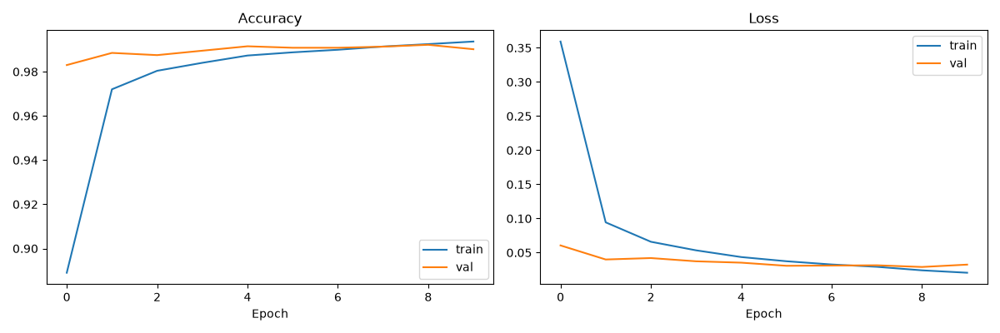
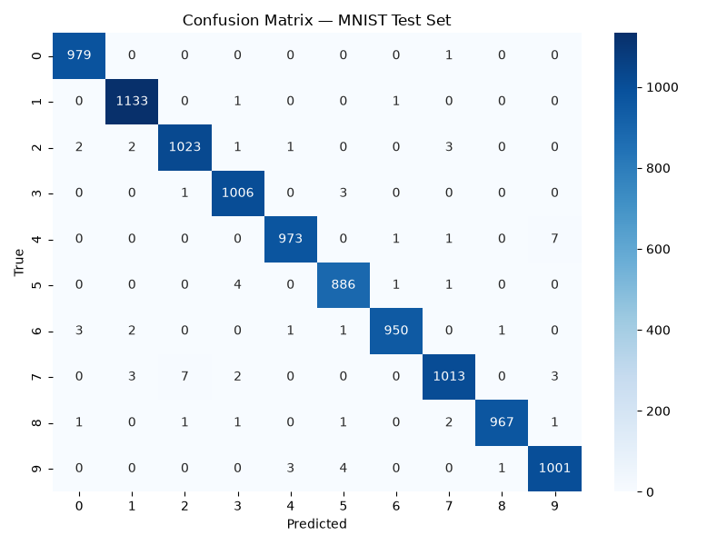
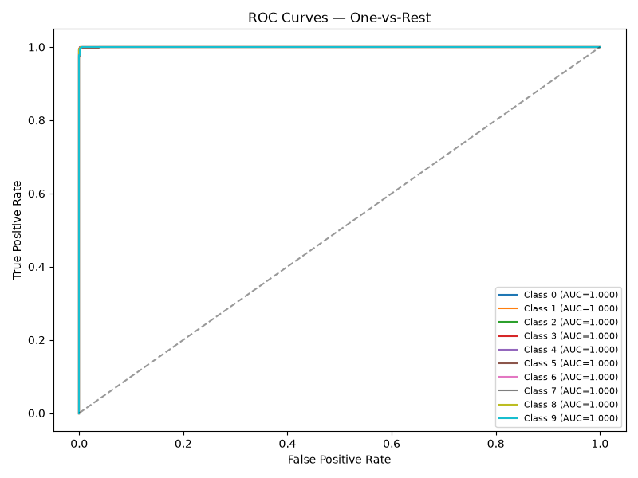

# ✍️ Handwritten Character Recognition — CodeAlpha ML Internship

A Convolutional Neural Network (CNN) that recognizes handwritten digits (MNIST), deployed as an interactive Streamlit web app.

**Intern:** Sawadogo Noé  
**Program:** CodeAlpha Machine Learning Internship (Nov 10 – Dec 10, 2026)

---

## 📌 Project Overview

End-to-end deep learning pipeline for handwritten digit recognition, covering preprocessing, CNN design, training, evaluation, and real-time inference via a web interface.

- **Dataset:** [MNIST](http://yann.lecun.com/exdb/mnist/) (60,000 train / 10,000 test, 28×28 grayscale)
- **Framework:** TensorFlow / Keras 2.21
- **Web App:** Streamlit
- **Test accuracy:** **99.31 %**

---

## 🧠 Model Architecture

```text
Input (28×28×1)
  → Conv2D(32, 3×3, ReLU) → MaxPool(2×2)
  → Conv2D(64, 3×3, ReLU) → MaxPool(2×2)
  → Conv2D(64, 3×3, ReLU)
  → Flatten
  → Dense(128, ReLU) → Dropout(0.5)
  → Dense(10, Softmax)
```

**Total trainable parameters:** 130,890 (~511 KB).

---

## 📊 Results

Evaluated on the 10,000-image MNIST test set:

| Metric | Value |
|---|---|
| Test Accuracy | **99.31 %** |
| Precision (macro) | 0.9931 |
| Recall (macro) | 0.9931 |
| F1-score (macro) | 0.9931 |
| Trainable parameters | 130,890 (~511 KB) |
| Training time (CPU) | ~5 min (10 epochs) |

### Per-class performance

| Digit | Precision | Recall | F1-score |
|:---:|:---:|:---:|:---:|
| 0 | 0.9939 | 0.9990 | 0.9964 |
| 1 | 0.9939 | 0.9982 | 0.9960 |
| 2 | 0.9913 | 0.9913 | 0.9913 |
| 3 | 0.9911 | 0.9960 | 0.9936 |
| 4 | 0.9949 | 0.9908 | 0.9929 |
| 5 | 0.9899 | 0.9933 | 0.9916 |
| 6 | 0.9969 | 0.9916 | 0.9942 |
| 7 | 0.9922 | 0.9854 | 0.9888 |
| 8 | 0.9979 | 0.9928 | 0.9954 |
| 9 | 0.9891 | 0.9921 | 0.9906 |

### Visualizations





The model makes only ~69 errors on 10,000 test images, with no class below 98.8 % F1 — indicating balanced performance across all digits.

---

## 🌐 Live Demo

Run the interactive web app locally:

```bash
streamlit run app/streamlit_app.py
```

Draw a digit with your mouse or upload an image — the CNN predicts in real time.

<!-- Add your Streamlit Cloud URL here once deployed: [**Launch App**](https://your-app-url.streamlit.app) -->

---

## 🗂 Project Structure

```text
├── app/
│   └── streamlit_app.py          # interactive web app
├── src/
│   ├── preprocess.py             # data loading & normalization
│   ├── train.py                  # model build + training
│   ├── evaluate.py               # metrics + plots
│   ├── predict.py                # CLI single-image inference
│   └── export_sample.py          # export MNIST samples as PNG
├── models/
│   └── cnn_mnist.h5              # trained model (511 KB)
├── results/                      # metrics, confusion matrix, ROC, curves
├── samples/                      # sample images for testing
├── requirements.txt
├── .gitignore
└── README.md
```

---

## 🚀 How to Run

### 1. Setup

```bash
python -m venv .venv
# Windows:
.venv\Scripts\activate
# macOS/Linux:
source .venv/bin/activate

pip install -r requirements.txt
```

### 2. Train the model

```bash
cd src
python train.py
```

Produces `models/cnn_mnist.h5` and `results/training_curves.png`.

### 3. Evaluate

```bash
python evaluate.py
```

Outputs accuracy, per-class report, confusion matrix, ROC curves in `results/`.

### 4. Predict on a single image

```bash
python predict.py --image ../samples/digit_7_0.png
```

### 5. Launch the web app

```bash
cd ..
streamlit run app/streamlit_app.py
```

---

## 🔮 Future Improvements

- Extend to EMNIST (letters a–z, A–Z).
- Full-word recognition with CRNN + CTC loss.
- Data augmentation (rotation, shift, zoom) for real-world robustness.
- Deploy on Streamlit Community Cloud for a public URL.

---

## 📜 License

Educational project — CodeAlpha Internship, 2026.